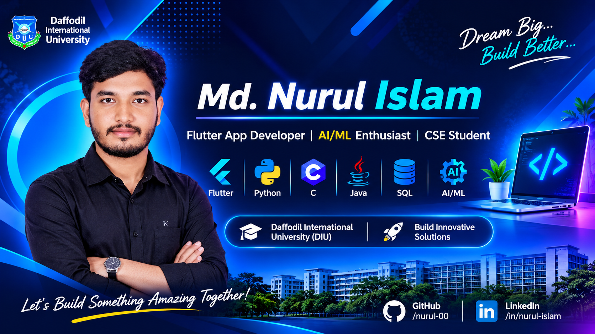

<h1 align="center">Hi 👋, I'm Md. Nurul Islam</h1>

<h3 align="center">
  Flutter App Developer | AI/ML Enthusiast | CSE Student
</h3>

  

  

  

---

## 👨‍💻 About Me

Hello! I'm **Md. Nurul Islam**, a Computer Science and Engineering student at **Daffodil International University (DIU)**, Bangladesh.

I'm passionate about software development, mobile applications, and Artificial Intelligence.

- 🎓 CSE Student at Daffodil International University
- 📱 Interested in Flutter App Development
- 🤖 Currently exploring AI and Machine Learning
- 🐍 Learning Python, NumPy, Pandas and Data Science
- 💻 Experienced with C, Java and Dart fundamentals
- 🔬 Interested in AI-based research and practical applications
- 🚀 Working towards becoming an AI/ML Engineer

---

## 🎯 Current Focus

- Python Programming for AI/ML
- NumPy and Pandas
- Machine Learning Fundamentals
- Data Science and Data Analysis
- Flutter Application Development
- Building practical software projects

---

## 🛠️ Technical Skills

### 💻 Programming Languages

  

### 📱 App Development

  

### 🗄️ Database & Development Tools

  

### 🤖 AI / ML & Data Science

  

---

## 📚 Learning Journey

| Area | Current Interest |
|---|---|
| Artificial Intelligence | AI Fundamentals |
| Machine Learning | ML Algorithms |
| Data Science | NumPy, Pandas |
| Deep Learning | Neural Networks |
| Mobile Development | Flutter |
| Research | Medical Image Classification |

---

## 📊 GitHub Analytics

  
  

---

## 🔥 Contribution Streak

  

---

## 🏆 GitHub Trophies

  

---

## 🌐 Connect With Me

  
  

---

<h3 align="center">
  💙 Learning | Building | Innovating
</h3>

  <i>"Consistency is the key to growth."</i>

